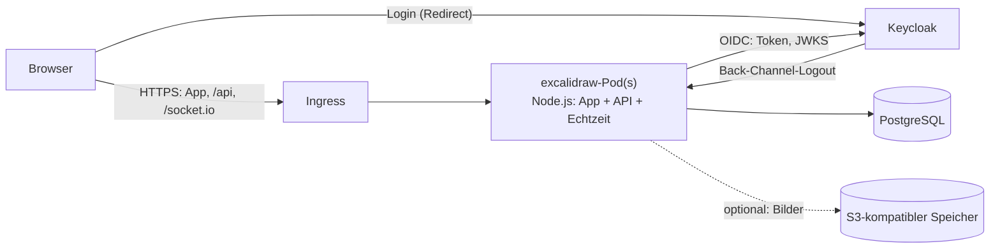

# Excalidraw im Intranet

Dieser Fork macht Excalidraw zu einem Dienst für das Unternehmensnetz:

- **Anmeldung über Keycloak** (OpenID Connect), Rollen und Gruppen aus Keycloak
- **eigener Server** statt der Cloud-Dienste von excalidraw.com (Firebase, Teilen-, Collab- und KI-Server)
- **keine Aufrufe ins Internet**: keine Analytics, keine CDNs, keine Excalidraw+-Werbung; ein Browser-Test prüft das bei jedem Lauf
- **ein Container-Image** und ein **Helm-Chart** für Kubernetes

Welche Excalidraw+-Funktionen nach und nach dazukommen, steht in der [Roadmap](./roadmap.md).

## Architektur



Ein Pod liefert die gebaute App aus, beantwortet die API unter `/api` und betreibt die Live-Zusammenarbeit über Websockets unter `/socket.io`. Mehrere Pods stimmen sich über PostgreSQL ab (`REALTIME_CLUSTER`), ein Redis ist nicht nötig.

| Baustein | Ersetzt | Wo im Code |
| --- | --- | --- |
| Anmeldung, Sitzungen, Rollen | — (upstream hat keine) | `excalidraw-server/src/auth` |
| Szenen der Live-Sitzungen, Bilder | Firebase Firestore und Storage | `excalidraw-server/src/routes/data.ts`, `excalidraw-app/data/firebase.ts` |
| Teilen-Links (`#json=`) | json.excalidraw.com | `/api/v2` im selben Protokoll |
| Echtzeit-Server | oss-collab.excalidraw.com (excalidraw-room) | `excalidraw-server/src/realtime` |
| Anmelde-Prüfung der App | — | `excalidraw-app/intranet` |

### Sicherheit

- **Sitzungen** liegen auf dem Server; der Browser hält nur ein zufälliges Token im HttpOnly-Cookie, in der Datenbank steht nur dessen SHA-256. Keycloak-Tokens erreichen den Browser nie (Backend-for-Frontend).
- **Login** per Authorization Code Flow mit PKCE, `state` und `nonce`, an den Browser gebunden (Schutz vor Login-CSRF), Rücksprung nur auf Pfade der eigenen Seite.
- **Abmelden** beendet auch die Keycloak-Sitzung. Meldet Keycloak eine Abmeldung per Back-Channel, endet die Sitzung sofort, offene Live-Verbindungen werden getrennt.
- **Ende-zu-Ende-Verschlüsselung** von Live-Sitzungen und Teilen-Links bleibt wie bei excalidraw.com: Der Schlüssel steht im URL-Fragment, der Server speichert nur Chiffretext. Auch beim Login-Umweg verlässt der Schlüssel den Browser nicht.
- **Schreibende API-Aufrufe** müssen von der eigenen Origin kommen (Schutz vor CSRF aus anderen Intranet-Anwendungen derselben Domain), Websockets ebenso.
- **Content-Security-Policy** erlaubt nur die eigene Origin (plus Keycloak als Formularziel). Inline-Skripte sind per Hash freigegeben.

## Schnellstart zum Ausprobieren

Voraussetzung: Docker mit Compose.

```bash
docker compose -f deploy/compose/docker-compose.yml up --build
```

Danach <http://localhost:3000> öffnen und anmelden als `alice`/`alice` (Admin), `bob`/`bob` (Nutzer) oder `carol`/`carol` (ohne Excalidraw-Rolle, wird abgewiesen). Die Keycloak-Konsole läuft unter <http://localhost:8080> (`admin`/`admin`).

## Weiter

- [Betrieb: Image, Helm, Keycloak, Konfiguration](./betrieb.md)
- [Entwicklung: lokal starten, Tests, Upstream-Updates](./entwicklung.md)
- [Roadmap: Priorisierung und Phasen](./roadmap.md)
