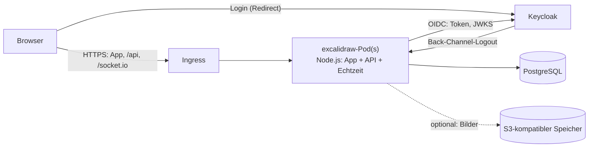

# Excalidraw im Intranet

Dieser Fork macht Excalidraw zu einem Dienst für das Unternehmensnetz:

- **Anmeldung über Keycloak** (OpenID Connect), Rollen und Gruppen aus Keycloak
- **Workspace**: Szenen auf dem Server, Dashboard, Collections für Teams, Teilen mit Personen und Keycloak-Gruppen, Nur-Lese-Links, dauerhafte Live-Zusammenarbeit
- **Kommentare** an Stellen und Elementen einer Szene, mit Antworten und „Erledigt“
- **REST-API** und **MCP-Server** für Skripte und KI-Assistenten, mit persönlichen API-Tokens ([REST-API](./api.md), [MCP](./mcp.md))
- **eigener Server** statt der Cloud-Dienste von excalidraw.com (Firebase, Teilen-, Collab- und KI-Server)
- **keine Aufrufe ins Internet**: keine Analytics, keine CDNs, keine Excalidraw+-Werbung; ein Browser-Test prüft das bei jedem Lauf
- **ein Container-Image** und ein **Helm-Chart** für Kubernetes

Welche Excalidraw+-Funktionen nach und nach dazukommen, steht in der [Roadmap](./roadmap.md).

## Architektur



Ein Pod liefert die gebaute App aus, beantwortet die API unter `/api` und betreibt die Live-Zusammenarbeit über Websockets unter `/socket.io`. Mehrere Pods stimmen sich über PostgreSQL ab (`REALTIME_CLUSTER`), ein Redis ist nicht nötig.

| Baustein | Ersetzt | Wo im Code |
| --- | --- | --- |
| Anmeldung, Sitzungen, Rollen | — (upstream hat keine) | `excalidraw-server/src/auth` |
| Szenen der Live-Sitzungen, Bilder | Firebase Firestore und Storage | `excalidraw-server/src/routes/data.ts`, `excalidraw-app/data/firebase.ts` |
| Teilen-Links (`#json=`) | json.excalidraw.com | `/api/v2` im selben Protokoll |
| Echtzeit-Server | oss-collab.excalidraw.com (excalidraw-room) | `excalidraw-server/src/realtime` |
| Anmelde-Prüfung der App | — | `excalidraw-app/intranet` |
| Workspace: Szenen, Collections, Freigaben | Excalidraw+ | `excalidraw-server/src/workspace`, `excalidraw-app/workspace` |
| Kommentare | Excalidraw+ | `excalidraw-server/src/workspace/comments.ts`, `excalidraw-app/workspace/comments` |
| REST-API, API-Tokens | Excalidraw+ API | `excalidraw-server/src/api`, `excalidraw-server/src/auth/tokens.ts` |
| MCP-Server | – | `excalidraw-server/src/mcp` |
| Element-Logik des Editors auf dem Server | – | `excalidraw-server/elements` (gebündelt aus `packages/`) |

### Sicherheit

- **Sitzungen** liegen auf dem Server; der Browser hält nur ein zufälliges Token im HttpOnly-Cookie, in der Datenbank steht nur dessen SHA-256. Keycloak-Tokens erreichen den Browser nie (Backend-for-Frontend).
- **Login** per Authorization Code Flow mit PKCE, `state` und `nonce`, an den Browser gebunden (Schutz vor Login-CSRF), Rücksprung nur auf Pfade der eigenen Seite.
- **Abmelden** beendet auch die Keycloak-Sitzung. Meldet Keycloak eine Abmeldung per Back-Channel, endet die Sitzung sofort, offene Live-Verbindungen werden getrennt.
- **Ende-zu-Ende-Verschlüsselung** von Live-Sitzungen und Teilen-Links bleibt wie bei excalidraw.com: Der Schlüssel steht im URL-Fragment, der Server speichert nur Chiffretext. Auch beim Login-Umweg verlässt der Schlüssel den Browser nicht.
- **Workspace-Szenen** liegen verschlüsselt in der Datenbank. Jede Szene hat einen eigenen Schlüssel, mit dem der Browser Inhalt und Bilder verschlüsselt; der Server bewahrt ihn nur versiegelt mit dem Hauptschlüssel `DATA_ENCRYPTION_KEY` auf (Envelope-Verschlüsselung) und gibt ihn nur an Berechtigte heraus. Ein Datenbank-Dump, der S3-Bucket oder ein Backup allein verraten keine Zeichnungen, Bilder oder Vorschaubilder; im Klartext stehen nur Namen von Szenen und Collections und wer worauf Zugriff hat. Anders als bei Ad-hoc-Sitzungen ist das keine Ende-zu-Ende-Verschlüsselung: Der Server kann den Schlüssel öffnen, sonst könnte er Freigaben nicht durchsetzen.
- **Zugriff** wird bei jeder Anfrage und beim Betreten eines Live-Raums geprüft. Wer nur ansehen darf, kann über die Live-Verbindung nichts ändern: Der Server entschlüsselt deren Nachrichten mit dem Szenenschlüssel und leitet nur Mauszeiger, Status und Ansichtsbereich weiter. Ändern sich Freigaben, prüft der Server offene Live-Verbindungen sofort neu; wer den Zugriff verliert oder eine andere Rolle bekommt, wird getrennt, und die App lädt die Szene mit den aktuellen Rechten neu. Unbekannte und fremde Szenen sind nicht unterscheidbar (beide 404).
- **Schreibende API-Aufrufe** müssen von der eigenen Origin kommen (Schutz vor CSRF aus anderen Intranet-Anwendungen derselben Domain), Websockets ebenso.
- **Content-Security-Policy** erlaubt nur die eigene Origin (plus Keycloak als Formularziel). Inline-Skripte sind per Hash freigegeben.
- **API-Tokens** werden nur einmal angezeigt und als SHA-256 gespeichert; sie handeln mit den Rechten ihrer Person, haben eine Ablaufzeit und lassen sich widerrufen. `/api/v1` und `/mcp` nehmen nur Tokens, keine Cookies (kein CSRF), die App nimmt umgekehrt keine Tokens.
- **Kommentare** sind wie die Zeichnung mit dem Szenenschlüssel verschlüsselt.

## Bedienung

| Adresse | Inhalt |
| --- | --- |
| `/` | Dashboard: zuletzt geöffnete Szenen, „Meine Szenen“, „Mit mir geteilt“, Aktivität, Team-Collections, Papierkorb, Suche in Namen, Zeichnungen und Kommentaren, Export als ZIP; oben links der Wechsel zwischen Workspaces |
| `/s/<id>` | Workspace-Szene. Alle, die sie gerade geöffnet haben, arbeiten live zusammen; Änderungen werden laufend auf dem Server gespeichert |
| `/v/<token>` | Nur-Lese-Link einer Szene. Nur für angemeldete Personen, öffnet die Szene in der Ansicht |
| `/local` | Lokale Zeichnung wie auf excalidraw.com, nur im Browser gespeichert; über das Menü „Im Workspace speichern“ wird daraus eine Szene |
| `/admin` | Verwaltung für App-Admins (Workspaces, Personen, Audit-Log, Branding, Kennzahlen) und Workspace-Admins (ihre Workspaces) |
| `/#room=…`, `/#json=…` | Ad-hoc-Live-Sitzung bzw. Teilen-Link mit Ende-zu-Ende-Verschlüsselung (wie bisher) |

Rechte:

- **Meine Szenen** sieht nur die Person selbst, solange sie eine Szene nicht teilt.
- **Team-Collections** legt jede angemeldete Person an. Eingetragene Personen oder Keycloak-Gruppen erhalten „Kann ansehen“, „Kann bearbeiten“ oder „Verwaltet“. Eine Freigabe an eine Gruppe gilt auch für ihre Untergruppen (`/IT` umfasst `/IT/Architektur`). Admins (`excalidraw-admin`) sehen und verwalten alle Team-Collections.
- **Einzelne Szenen** lassen sich zusätzlich an Personen oder Gruppen freigeben, ohne die Collection zu öffnen.
- **Kommentare** schreibt jede Person, die die Szene sehen darf, auch mit Leserecht. Erledigen darf, wer bearbeiten darf, und wer den Kommentar begonnen hat; löschen darf die Verfasserin bzw. der Verfasser und wer die Szene verwaltet.
- **Workspaces**: Der allgemeine Workspace ist für alle offen. Weitere Workspaces legen App-Admins an und tragen Mitglieder (Personen oder Keycloak-Gruppen) und Workspace-Admins ein. Workspace-Admins verwalten alle Team-Collections, Mitglieder und Richtlinien ihres Workspaces (Nur-Lese-Links, direktes Teilen, wer Collections anlegt, wer exportiert, Frist im Papierkorb). Wer kein Mitglied ist, sieht dort nur, was mit ihm geteilt wurde.
- **Papierkorb**: Gelöschte Szenen holt zurück, wer sie bearbeiten durfte oder sie gelöscht hat. Nach der Frist (Standard 30 Tage) sind sie endgültig weg.
- **Versionen**: im Editor über das Hauptmenü „Versionsverlauf…“; alle mit Zugriff über eine Collection oder Freigabe sehen frühere Stände (über einen Nur-Lese-Link nicht), wer bearbeiten darf, stellt einen wieder her.

Kommentieren: im Editor oben rechts das Sprechblasen-Symbol, dann „Kommentar hinzufügen“ und auf die Stelle klicken. Liegt dort ein Element, hängt der Kommentar daran und wandert mit, wenn es verschoben wird.

## Schnellstart zum Ausprobieren

Voraussetzung: Docker mit Compose.

```bash
docker compose -f deploy/compose/docker-compose.yml up --build
```

Danach <http://localhost:3000> öffnen und anmelden als `alice`/`alice` (Admin, Gruppe `/IT/Architektur`), `bob`/`bob` (Nutzer, Gruppe `/Vertrieb`) oder `carol`/`carol` (ohne Excalidraw-Rolle, wird abgewiesen). Die Keycloak-Konsole läuft unter <http://localhost:8080> (`admin`/`admin`).

Zum Ausprobieren der Freigaben in einem zweiten Browserprofil (oder privaten Fenster) mit einer anderen Person anmelden.

## Weiter

- [Betrieb: Image, Helm, Keycloak, Konfiguration, Monitoring, Backup](./betrieb.md)
- [Datenschutz und Löschkonzept](./datenschutz.md)
- [Entwicklung: lokal starten, Tests, Upstream-Updates](./entwicklung.md)
- [REST-API: Tokens, Endpunkte, Beispiele](./api.md)
- [MCP-Server: KI-Assistenten anbinden](./mcp.md)
- [Roadmap: Priorisierung und Phasen](./roadmap.md)
